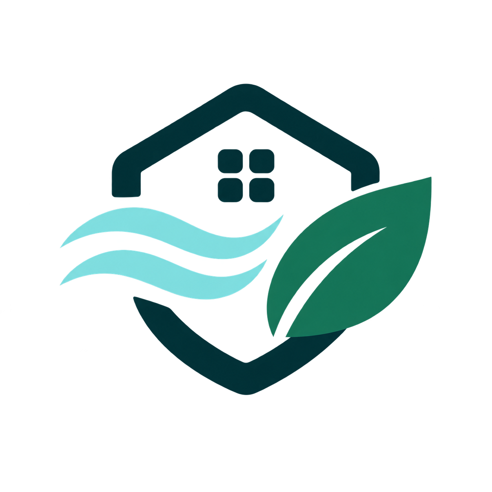
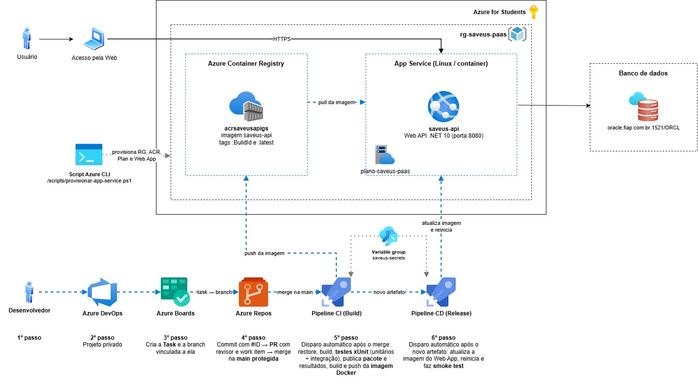

<div align="center">

#  SaveUs

**API que conecta idosos a refúgios climáticos durante ondas de calor**

*Busca de refúgios por bairro, reserva de vagas com comprovante e gestão dos refúgios, com deploy contínuo na Azure*


> Projeto acadêmico desenvolvido para fins educacionais.

</div>

## Integrantes

| Nome | RM |
|---|---|
| 👩‍💻 Anna Clara Russo Luca | RM561928 |
| 👨‍💻 Gabriel Duarte Maciel | RM565754 |
| 👨‍💻 Gustavo Tavares da Silva | RM562827 |
| 👨‍💻 Tiago Guedes da Costa | RM564731 |

---

# 📑 Sumário

- [📌 Descrição do Projeto](#-descrição-do-projeto)
- [🏗 Arquitetura da Solução](#-arquitetura-da-solução)
- [🚀 Tecnologias Utilizadas](#-tecnologias-utilizadas)
- [💼 Benefícios para o Negócio](#-benefícios-para-o-negócio)
- [🧩 CRUD Implementado](#-crud-implementado)
- [☁️ Como Fazer o Deploy em Cloud (Azure)](#️-como-fazer-o-deploy-em-cloud-azure)
- [🧩 Componentes da Arquitetura Cloud](#-componentes-da-arquitetura-cloud)
- [🔗 Projeto no Azure DevOps](#-projeto-no-azure-devops)
- [📊 Benefícios da Arquitetura em Cloud](#-benefícios-da-arquitetura-em-cloud)
- [▶ Demonstração](#-demonstração)

---

# 📌 Descrição do Projeto

O **Refúgio** ajuda idosos a enfrentar ondas de calor. Prédios públicos frescos (bibliotecas, CEUs, UBSs e centros comunitários) viram **refúgios climáticos**: o idoso encontra um refúgio aberto no bairro, reserva uma vaga e mostra o comprovante na porta. O gestor cadastra e mantém os refúgios. A solução se conecta às **ODS 3** (Saúde e Bem-Estar), **11** (Cidades e Comunidades Sustentáveis) e **13** (Ação Contra a Mudança Global do Clima).

Este repositório contém a **API REST** da solução, a única API consumida pelo app Mobile. Ela:

- autentica idosos e gestores (JWT) e controla o acesso por papel;
- mantém os refúgios (CRUD do gestor) e preenche o endereço pelo CEP (ViaCEP);
- controla as reservas: vagas por dia, uma reserva por idoso por dia, cancelamento e comprovante;
- evita reserva duplicada (`Idempotency-Key`), limita requisições (429) e expõe a saúde da API, do banco e do ViaCEP.

| Papel | Como é criado | O que faz |
|---|---|---|
| `IDOSO` | Cadastro público em `POST /auth/registrar` | Busca refúgios no bairro, reserva vaga, consulta o comprovante e cancela reservas. |
| `GESTOR` | Script do banco ou seed da API (não há cadastro público) | Cadastra, edita, desativa e exclui refúgios; consulta endereço pelo CEP. |

A API foi desenvolvida em **.NET 10 (ASP.NET Core Minimal APIs)**, com banco **Oracle Database em nuvem** disponibilizado pela FIAP. Ela roda em **contêiner Docker** no **Azure App Service (Web App for Containers)**, com a imagem armazenada no **Azure Container Registry (ACR)**.

A integração e a entrega contínuas são feitas no **Azure DevOps**: Azure Boards para as tarefas, Azure Repos com branch protegida e Pull Request, e Azure Pipelines para compilar, testar, gerar a imagem e implantar a nova versão.

O projeto demonstra na prática:

- Cloud Computing (PaaS) com contêineres.
- Registro privado de imagens (ACR).
- Persistência em banco relacional na nuvem.
- Integração contínua (CI) e entrega contínua (CD).
- Automação de build, testes, publicação da imagem e deploy.
- Gerenciamento seguro de segredos (variable group e app settings).

---

# 🏗 Arquitetura da Solução



**Fluxo de acesso à aplicação:**

1. O idoso ou o gestor acessa o Refúgio pelo app Mobile, que consome esta API via HTTPS.
2. A requisição chega ao **Azure App Service** (Linux / contêiner), no Web App `saveus-api`.
3. O App Service executa a imagem `saveus-api` baixada do ACR `acrsaveusapigs`, usando os recursos do plano `plano-saveus-paas`.
4. A API se comunica com o **Oracle Database da FIAP** (`oracle.fiap.com.br:1521/ORCL`) via EF Core.
5. Refúgios, reservas e usuários são gravados e consultados nas tabelas `T_RFG_*`.

**Fluxo de desenvolvimento e implantação:**

1. O desenvolvedor trabalha no projeto privado do **Azure DevOps**.
2. No **Azure Boards**, cria a Task e a branch vinculada a ela.
3. No **Azure Repos**, faz o commit com `#ID` da tarefa e abre um **Pull Request** com revisor e work item vinculado; o merge só entra na `main` protegida por PR.
4. O merge dispara a **Pipeline CI (Build)**: restore, build, testes xUnit (unitários e de integração), publicação do pacote e dos resultados, e build + push da imagem Docker no ACR.
5. Com o novo artefato, a **Pipeline CD (Release)** atualiza a imagem do Web App, reinicia e faz o **smoke test** em `/health`.

---

# 🚀 Tecnologias Utilizadas

## Back-end

| | |
|---|---|
| API | .NET 10, ASP.NET Core Minimal APIs |
| Persistência | EF Core 10 com migrações (provider Oracle) |
| Segurança | JWT Bearer (papéis `IDOSO` e `GESTOR`), senha com PBKDF2, rate limiting nativo |
| Validação e erros | FluentValidation; todo erro em ProblemDetails |
| Documentação | OpenAPI + Swagger UI (`/swagger`) |
| Monitoramento | Health Checks (`/health`: API, banco e ViaCEP) |
| Testes | xUnit: unitários (regras de negócio) e de integração (WebApplicationFactory + Oracle) |

Camadas: `Domain` (regras) ← `Application` (casos de uso, DTOs, validação) ← `Infrastructure` (EF Core, JWT, ViaCEP) ← `Api` (endpoints).

## Banco de Dados

- Oracle Database 19c (instância em nuvem da FIAP).
- Tabelas com prefixo `T_RFG_*`.
- Migrações do EF Core aplicadas na inicialização.
- Script SQL de apoio em [scripts/script-bd.sql](scripts/script-bd.sql).

## Cloud e DevOps

- Microsoft Azure (assinatura Azure for Students).
- Azure Resource Group.
- Azure Container Registry (ACR).
- Azure App Service Plan (Linux).
- Azure App Service — Web App for Containers.
- Docker.
- Azure DevOps: Boards, Repos e Pipelines.
- Azure CLI para provisionar a infraestrutura.

---

# 💼 Benefícios para o Negócio

### Proteção a um público vulnerável

Idosos são os mais afetados por ondas de calor. A API dá a eles um caminho simples para achar um lugar fresco perto de casa e garantir a vaga antes de sair.

### Aproveitamento de equipamentos públicos

Bibliotecas, CEUs e UBSs que já existem passam a funcionar como refúgios, sem custo de nova infraestrutura física.

### Controle de lotação

As vagas são contadas por dia e cada idoso só pode ter uma reserva por dia. O gestor sabe quantas pessoas esperar, e o refúgio não fica superlotado.

### Confiabilidade nas reservas

A `Idempotency-Key` impede reserva duplicada quando a conexão cai e o app reenvia o pedido, e o rate limiting protege a API contra excesso de requisições.

### Entrega automatizada

Cada merge na `main` passa por build, testes e deploy sem etapas manuais, o que reduz erros e acelera a entrega de correções.

### Segurança das configurações

Credenciais do banco e a chave do JWT ficam no variable group do Azure DevOps e nas app settings do Web App, fora do código-fonte.

---

# 🧩 CRUD Implementado

O CRUD completo está na entidade **Refúgio** (tabela `T_RFG_REFUGIO`), operada pelo gestor. As rotas exigem `Authorization: Bearer {{token}}` de um usuário com papel `GESTOR`. Sem token, a API devolve 401; com token de `IDOSO`, devolve 403 nas operações de escrita.

| Operação | Ação no sistema | Rota | Retorno |
|---|---|---|---|
| Incluir | Cadastrar refúgio | `POST /api/v1/refugios` | 201 |
| Consultar | Listar (filtros e paginação) | `GET /api/v1/refugios?pagina=1&tamanho=10` | 200 |
| Consultar | Detalhar refúgio | `GET /api/v1/refugios/{id}` | 200 / 404 |
| Alterar | Editar dados, capacidade, horário ou desativar | `PUT /api/v1/refugios/{id}` | 200 / 400 / 404 |
| Excluir | Remover refúgio | `DELETE /api/v1/refugios/{id}` | 204 / 409 |

### 0. Login do gestor (obter o token)

`POST /auth/login`

```json
{
  "email": "gestor@refugio.com",
  "senha": "Senha@123"
}
```

Resposta `200`: `token`, `expiraEm` e `usuario`. O token vai no header `Authorization: Bearer <token>`.

### 1. Create — cadastrar refúgio

`POST /api/v1/refugios`

```json
{
  "nome": "Biblioteca Central",
  "tipo": "BIBLIOTECA",
  "cep": "01001000",
  "endereco": "Praça da Sé, 100",
  "bairro": "Sé",
  "capacidade": 40,
  "abre": "08:00:00",
  "fecha": "18:00:00",
  "acessivel": true,
  "ativo": true
}
```

Resposta `201` com o `id` criado e `vagasDisponiveis`. Valores aceitos em `tipo`: `BIBLIOTECA`, `CENTRO_COMUNITARIO`, `CEU`, `UBS`, `ESCOLA`, `IGREJA`, `OUTRO`. `abre`/`fecha` aceitam `HH:mm` ou `HH:mm:ss`.

### 2. Read — consultar refúgios

`GET /api/v1/refugios?pagina=1&tamanho=10` (filtros opcionais: `bairro`, `data`, `ativo`)

`GET /api/v1/refugios/{id}`

```json
{
  "id": 6,
  "nome": "Biblioteca Central",
  "tipo": "BIBLIOTECA",
  "cep": "01001000",
  "endereco": "Praça da Sé, 100",
  "bairro": "Sé",
  "capacidade": 40,
  "vagasDisponiveis": 40,
  "abre": "08:00",
  "fecha": "18:00",
  "acessivel": true,
  "ativo": true
}
```

### 3. Update — alterar refúgio

`PUT /api/v1/refugios/{id}` (corpo completo, igual ao POST)

```json
{
  "nome": "Biblioteca Central",
  "tipo": "BIBLIOTECA",
  "cep": "01001000",
  "endereco": "Praça da Sé, 100",
  "bairro": "Sé",
  "capacidade": 50,
  "abre": "08:00:00",
  "fecha": "20:00:00",
  "acessivel": true,
  "ativo": true
}
```

Resposta `200` com o refúgio atualizado.

### 4. Delete — excluir refúgio

`DELETE /api/v1/refugios/{id}` (sem corpo)

Resposta `204`. Se o refúgio tiver reservas ativas futuras, a API devolve `409`; na demonstração, exclua um refúgio recém-criado.

### Conferência no banco

Depois de cada operação, a persistência é conferida direto no Oracle:

```sql
SELECT * FROM T_RFG_REFUGIO ORDER BY ID DESC;
```

> As reservas dos idosos (`T_RFG_RESERVA`) também são gravadas pela API (`POST /api/v1/reservas`, `GET /api/v1/reservas/minhas`, `DELETE /api/v1/reservas/{id}` para cancelar), mas o CRUD demonstrado é o de Refúgio.

---

# ☁️ Como Fazer o Deploy em Cloud (Azure)

O Refúgio é implantado na **Microsoft Azure** como contêiner: a imagem fica no **Azure Container Registry** e roda no **Azure App Service (Web App for Containers)**. Os dados ficam no Oracle Database da FIAP.

O deploy é automatizado pelo **Azure DevOps**, com pipeline de CI/CD em [azure-pipeline.yml](azure-pipeline.yml).

> 💡 **Importante:** o Oracle usado pelo projeto é a instância da FIAP, hospedada fora da Azure. Não é preciso criar banco de dados na assinatura Azure.

## 1️⃣ Clonar o Repositório

```bash
git clone https://github.com/annaclrl/saveUs-cloud.git

cd saveUs-cloud
```

## 2️⃣ Preparar o Ambiente

É necessário ter instalado:

- .NET SDK 10.
- Git.
- Docker (para rodar o contêiner localmente).
- Azure CLI.
- PowerShell (para o script de provisionamento).
- SQL Developer ou DBeaver (opcional, para o script do banco).

Faça login na Azure e confira a assinatura:

```bash
az login
az account show
```

## 3️⃣ Configurar os Recursos na Azure

| Recurso | Nome | Finalidade |
|---|---|---|
| Assinatura | Azure for Students | Disponibiliza os recursos em nuvem. |
| Resource Group | `rg-saveus-paas` | Agrupa os recursos da aplicação. |
| Container Registry | `acrsaveusapigs` | Armazena a imagem `saveus-api` (tags `:BuildId` e `:latest`). |
| App Service Plan | `plano-saveus-paas` | Fornece os recursos de hospedagem (Linux, SKU B1). |
| Web App for Containers | `saveus-api` | Executa o contêiner da API (porta 8080). |
| Região | Canada Central | Região dos recursos. |

Os recursos são criados uma única vez pelo script [scripts/provisionar-app-service.ps1](scripts/provisionar-app-service.ps1), que usa o Azure CLI. Antes, copie `.env.example` para `.env` e preencha as credenciais do Oracle (o script lê esse arquivo para configurar o Web App):

```powershell
cp .env.example .env
./scripts/provisionar-app-service.ps1 -AcrNome acrsaveusapigs -WebAppNome saveus-api
```

O script executa, nesta ordem:

1. `az group create` — cria o Resource Group `rg-saveus-paas`.
2. `az acr create` — cria o ACR com usuário admin habilitado.
3. `az appservice plan create` — cria o plano Linux.
4. `az webapp create` e `az webapp config container set` — cria o Web App apontando para a imagem no ACR.
5. `az webapp config appsettings set` — grava as variáveis de ambiente, incluindo uma chave JWT aleatória gerada na hora.

Ao final, ele imprime o login server e o usuário do ACR, usados na Service Connection do Azure DevOps.

> O Web App só fica saudável depois que a pipeline publicar a imagem `saveus-api:latest` no ACR.

## 4️⃣ Configurar as Variáveis de Ambiente

| Variável | Onde fica | Finalidade |
|---|---|---|
| `ORACLE_USUARIO` | Variable group `saveus-secrets` / `.env` | Usuário do Oracle (RM). |
| `ORACLE_SENHA` | Variable group `saveus-secrets` / `.env` | Senha do Oracle. |
| `ORACLE_DATA_SOURCE` | Variable group `saveus-secrets` / `.env` | `oracle.fiap.com.br:1521/ORCL`. |
| `JWT_CHAVE` | Variable group `saveus-secrets` / `.env` | Chave de assinatura do JWT (mínimo 32 caracteres). |
| `SEED_SENHA_USUARIOS` | Variable group `saveus-secrets` / `.env` | Senha dos usuários de teste criados pelo seed. |
| `ConnectionStrings__Refugio` | App settings do Web App | Connection string montada a partir das variáveis do Oracle. |
| `Jwt__Chave` | App settings do Web App | Chave do JWT em produção. |
| `Seed__SenhaUsuarios` | App settings do Web App | Senha do seed em produção. |
| `Database__AplicarMigracoesAoIniciar` | App settings do Web App | Aplica as migrações do EF Core ao subir. |
| `WEBSITES_PORT` | App settings do Web App | Porta exposta pelo contêiner (`8080`). |

No Azure DevOps, as variáveis sensíveis ficam marcadas como secretas no variable group `saveus-secrets`. O `.env` é ignorado pelo Git.

## 5️⃣ Configurar o Azure DevOps

1. Crie (ou acesse) o projeto privado no Azure DevOps.
2. Importe o código no **Azure Repos**.
3. Proteja a branch `main` com política de PR: revisor obrigatório e work item vinculado.
4. Crie as **Service Connections**:
   - `conexao-acr-saveus` (Docker Registry) com as credenciais do ACR impressas pelo script;
   - `conexao-azure-saveus` (Azure Resource Manager) com acesso à assinatura.
5. Crie o **variable group** `saveus-secrets` com as variáveis da etapa anterior.
6. Crie o **Environment** `saveus-producao`.
7. Crie a pipeline apontando para o arquivo `azure-pipeline.yml`; o gatilho é a branch `main`.

## 6️⃣ Executar o Pipeline CI – Integração Contínua

O stage **Build** é disparado automaticamente após o merge na `main`. Ele roda em `ubuntu-latest` e executa:

1. Instalação do .NET SDK 10.
2. `dotnet restore` da solução `Refugio.slnx`.
3. `dotnet build` em Release.
4. `dotnet test` — testes xUnit unitários e de integração (contra o Oracle, com as variáveis do `saveus-secrets`).
5. Publicação dos resultados dos testes (`.trx`); a pipeline falha se algum teste falhar.
6. `dotnet publish` e publicação do artefato `saveus-api-pacote`.
7. Build e push da imagem Docker no ACR com as tags `$(Build.BuildId)` e `latest`.

Se o build ou os testes falharem, o stage de CD não é executado.

## 7️⃣ Executar o Pipeline CD – Entrega Contínua

Com o CI aprovado, o stage **Release** roda como deployment no Environment `saveus-producao`:

1. Via `AzureCLI@2`, aponta o Web App `saveus-api` para a imagem `saveus-api:$(Build.BuildId)` no ACR.
2. Reinicia o Web App.
3. Executa o **smoke test**: aguarda a subida e chama `/health`, com até 5 novas tentativas. Se a API não responder saudável, a pipeline falha.

Assim, cada merge na `main` vira uma nova versão no ar, sem build ou envio manual de imagem.

## 8️⃣ Acessar a Aplicação

Após o deploy, a API fica disponível em:

- **API:** https://saveus-api.azurewebsites.net
- **Swagger:** https://saveus-api.azurewebsites.net/swagger
- **Health check:** https://saveus-api.azurewebsites.net/health

Para parar a cobrança quando não estiver em uso:

```bash
az webapp stop  --resource-group rg-saveus-paas --name saveus-api   # desliga
az webapp start --resource-group rg-saveus-paas --name saveus-api   # religa
```
---

# 🧩 Componentes da Arquitetura Cloud

| Nome do Componente | Tipo | Descrição Funcional | Tecnologia / Ferramenta |
|---|---|---|---|
| Gestão de tarefas | Planejamento | Tasks vinculadas a branches e PRs. | Azure Boards |
| Repositório de Código | SCM | Armazena e versiona o código; `main` protegida por PR. | Git / Azure Repos |
| Pipeline CI | Continuous Integration | Compila, testa e gera a imagem Docker. | Azure Pipelines |
| Artefato | Build Artifact | Pacote publicado da API (`saveus-api-pacote`). | Pipeline Artifact |
| Registro de imagens | Container Registry | Armazena a imagem `saveus-api`. | Azure Container Registry |
| Pipeline CD | Continuous Delivery | Atualiza a imagem do Web App, reinicia e faz smoke test. | Azure Pipelines + Azure CLI |
| Segredos | Configuração segura | Credenciais do Oracle, chave JWT e senha do seed. | Variable group `saveus-secrets` |
| Web App | PaaS (contêiner) | Executa a API e a expõe via HTTPS. | Azure App Service (Web App for Containers) |
| Plano de Hospedagem | Compute Plan | Fornece CPU e memória ao Web App. | App Service Plan (Linux B1) |
| Banco de Dados | Banco relacional | Armazena usuários, refúgios e reservas. | Oracle Database FIAP |
| Gerenciamento de Recursos | Resource Management | Agrupa os recursos na Azure. | Azure Resource Group |
| Provisionamento | IaC (script) | Cria RG, ACR, Plan e Web App. | Azure CLI + PowerShell |

---

# 🔗 Projeto no Azure DevOps

O repositório, as tarefas e as pipelines de CI/CD estão no projeto do Azure DevOps:

🔗 [Projeto SaveUs no Azure DevOps](https://dev.azure.com/rm561928/Global%20Solution%20-SaveUs)

---

# 📊 Benefícios da Arquitetura em Cloud

- 🌍 **Acesso remoto:** API disponível por URL pública com HTTPS.
- 📦 **Portabilidade:** a mesma imagem Docker roda localmente e na Azure.
- ⚙️ **Automação CI/CD:** build, testes, imagem e deploy feitos pelo Azure DevOps.
- ✅ **Qualidade garantida:** a `main` só recebe código via PR revisado, e o deploy só ocorre com testes aprovados e smoke test.
- ⏪ **Rastreabilidade:** cada imagem tem a tag do `BuildId`, o que permite voltar a uma versão anterior.
- 🔒 **Segurança:** segredos no variable group e nas app settings, fora do código.
- 🗄️ **Persistência em nuvem:** dados no Oracle Database da FIAP, independentes do ciclo de vida do contêiner.
- 💰 **Controle de custo:** o Web App pode ser parado e religado pelo Azure CLI.

---

# ▶ Demonstração

Demonstração em vídeo da solução, do fluxo de CI/CD ao uso da API na nuvem:

🎥 [Assistir demonstração no YouTube](https://youtu.be/GPdDYCtVTpk)
